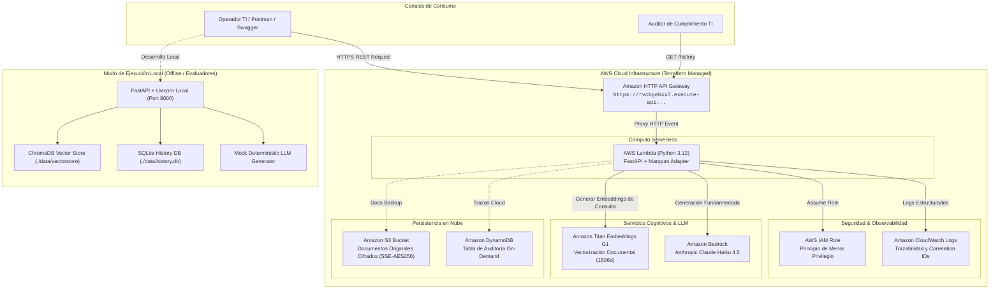
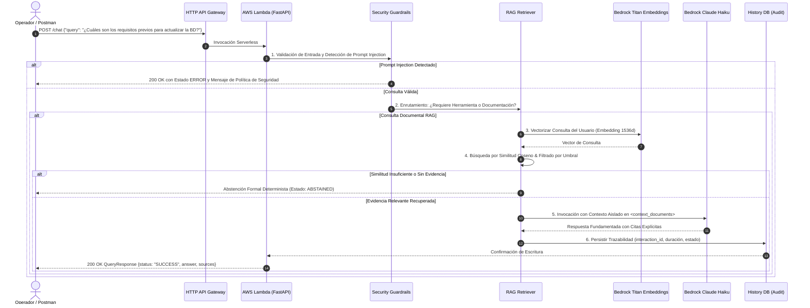

# Arquitectura: Enterprise AI Operations Assistant (Serverless AWS & Local)

## 1. Diagrama de Arquitectura de la Solución (Nube AWS & Local)

El sistema implementa una arquitectura desacoplada, observable y de bajo costo. Puede ejecutarse tanto en **AWS (Serverless con API Gateway + Lambda + Bedrock)** como en **entorno local (FastAPI + ChromaDB + SQLite)** sin alterar contratos ni interfaces.

---

## 2. Diagrama de Secuencia: Flujo de una Consulta RAG (`POST /chat`)

---

## 3. Justificación de Decisiones de Arquitectura

1. **AWS Lambda + HTTP API Gateway en lugar de ECS Fargate + ALB:**
   - **Costo:** ECS con Application Load Balancer genera un costo fijo aproximado de **$25 - $40 USD/mes** solo por mantener el balanceador encendido sin tráfico. La arquitectura Lambda + HTTP API Gateway tiene **costo $0.00 USD en reposo** y entra en la capa gratuita de AWS.
   - **Escalabilidad:** Escala instantáneamente de 0 a miles de peticiones por segundo sin necesidad de configurar auto-scaling groups.
2. **Amazon Titan Embeddings + Claude Haiku 4.5 en Bedrock:**
   - Provee la menor latencia y el menor costo por token del ecosistema Anthropic/AWS en `us-east-1`.
   - Soporta aislamiento estricto de prompts mediante tags XML contra inyecciones indirectas.
3. **Dualidad Local / Nube:**
   - Los evaluadores pueden ejecutar la solución en local con `pytest` sin gastar credenciales de nube gracias a ChromaDB + SQLite + Mock Provider, o invocar la URL pública en vivo de AWS.
